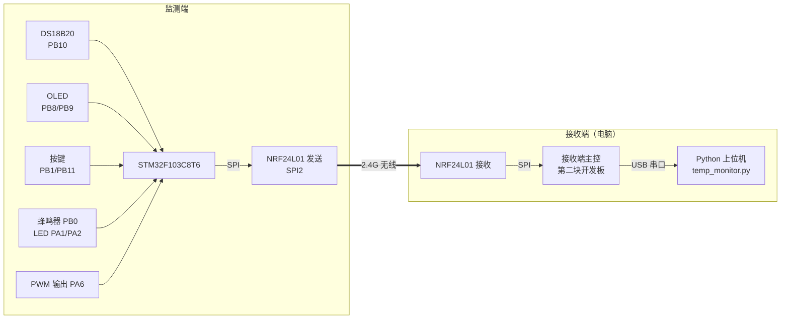

# 智能温度监测报警器

基于 **STM32F103C8T6** 的温度监测报警装置：实时采集环境温度并显示，按键设置报警阈值，超限本地声光报警，通过 **NRF24L01** 无线传送到电脑接收端，并把温度线性转换为 **0~3.3 V** 电压输出。

> 对应电子设计协会入会测试题《智能温度监测报警器》。设计与实施计划见 [planning.md](./planning.md)。

---

## 0. 警告：这些是错误道路，不要走

- ❌ **ESP8266 / WiFi**：本项目没有 ESP8266 模块，STM32F103C8 也没有 WiFi 能力。不要做热点、直连 WiFi、开网页服务器。
- ❌ **电脑无线网卡接收 NRF24L01**：无线网卡是 WiFi（802.11），NRF24L01 是 Nordic 私有 2.4G 协议，调制方式和通信协议完全不同，物理上解调不了（就像 FM 收音机收不到 WiFi）。
- ❌ **USB 转串口直连 8 脚 NRF24L01**：USB 转串口是 UART，NRF24L01 是 SPI，接口不同，不能直连。
- ✅ 正确方案：**NRF24L01 收发对**（监测端 + 接收端），接收端用**另一块开发板**做主控，再通过 USB 串口连电脑。

---

## 1. 完成状态

| 项目 | 状态 | 实现位置 |
| --- | --- | --- |
| 温度采集（DS18B20，PB10） | ✅ 已实现 | `Hardware/DS18B20.c` |
| OLED 显示（℃，实时更新） | ✅ 已实现 | `Hardware/OLED.c` |
| 按键设阈值（Key1 切换 / Key2 +1 / 长按 −1） | ✅ 已实现 | `User/main.c` |
| 本地声光报警（蜂鸣器 PB0 + LED PA1） | ✅ 已实现 | 触发：T>上限 或 T<下限；解除：回差 0.5 ℃ |
| 远程无线上报（NRF24L01 发送） | ✅ 已实现 | `Hardware/NRF24L01.c`，1 秒 1 帧 |
| 电压输出 0~3.3 V（PWM PA6） | ✅ 已实现 | 0~60 ℃ → 0~3.3 V 线性 |
| 电脑接收端（Python 上位机） | ✅ 已实现 | `PC_Software/temp_monitor.py` |
| 接收端固件（第二块开发板） | ✅ 已实现 | `User/main.c` 中 `NRF_ROLE_RECEIVER` |
| 0~10 V 输出（E2） | 🔧 软件已留接口 | `DAC_Output_SetMap()`，需加运放（12 V） |
| 硬件联调 | ⏳ 待硬件 | 需 2 块开发板 + 2 个 NRF24L01 |

---

## 2. 功能

- **温度采集与显示**：DS18B20 采集环境温度，OLED 实时显示（单位 ℃），随温度变化更新
- **阈值设置与本地报警**：按键设置温度上、下限；实测温度越限时自动触发声光报警（蜂鸣器 + LED）
- **远程监控**：监测端经 NRF24L01 上报温度与报警；电脑接收端（Python 上位机）实时显示，报警时变红并提示
- **温度-电压转换**：温度线性转换为 0~3.3 V 电压输出（PWM + RC 滤波）

---

## 3. 硬件连接

### 3.1 系统架构与数据流



> ⚠️ NRF24L01 没有 WiFi，也不是串口设备。模块用 **SPI** 接主控；电脑那头的接收器负责把无线数据转到 **USB 串口**。

### 3.2 监测端接线（STM32）

| 外设 | 引脚 | 说明 |
| --- | --- | --- |
| DS18B20 DQ | PB10 | 1-Wire，开漏输出，需 4.7 kΩ 上拉到 VCC |
| OLED SCL / SDA | PB8 / PB9 | 软件 I²C |
| 按键 Key1 / Key2 | PB1 / PB11 | 上拉输入，低电平有效 |
| 蜂鸣器 | PB0 | 有源蜂鸣器；低电平触发改 `Buzzer.c` 的 `BUZZER_ON_LEVEL` |
| LED1 / LED2 | PA1 / PA2 | 报警灯 / 状态灯，低电平点亮 |
| PWM 输出 | PA6 | → R10 kΩ → C100 nF → GND，输出 0~3.3 V |
| USART1 TX / RX | PA9 / PA10 | USB-TTL，本地设阈值/调试（可选） |

### 3.3 NRF24L01 接线（重点）

NRF24L01 模块（8 脚）与 STM32 的连线：

| NRF24L01 引脚 | STM32 引脚 | 说明 |
| --- | --- | --- |
| VCC | **3.3 V** | ⚠️ 必须 3.3 V，接 5 V 会烧模块 |
| GND | GND | 共地 |
| CE | PB6 | 收发使能（GPIO） |
| CSN | PB12 | SPI2 片选（GPIO） |
| SCK | PB13 | SPI2 时钟 |
| MOSI | PB15 | SPI2 主出从入 |
| MISO | PB14 | SPI2 主入从出 |
| IRQ | 不接 | 本驱动用状态寄存器轮询 |

> 监测端和接收端的 NRF24L01 接线完全相同（都是 SPI + CE）。

### 3.4 接收端（电脑）

接收端 = **第二块开发板 + NRF24L01**，跑接收端固件，通过 USB 串口连电脑：

| 接收端外设 | 引脚 | 说明 |
| --- | --- | --- |
| NRF24L01 | PB12/PB13/PB14/PB15/PB6 | 同监测端 |
| USART1 TX | PA9 | → USB 转串口 → 电脑 |

两端参数必须一致：**频道 76（2476 MHz）、1 Mbps、0 dBm、地址 `12 34 56 78 9A`、负载 16 字节**。

---

## 4. 构建与烧录

- **IDE**：Keil MDK 5（`E:\Keil_v5`，完整工具链在 E 盘），器件包 Keil.STM32F1xx_DFP 2.4.1
- **命令行构建**：

  ```powershell
  & "E:\Keil_v5\UV4\UV4.exe" -b Project.uvprojx -o build.log
  ```

  退出码 0 表示成功，日志写入 `build.log`（当前已验证：0 错误 0 警告）。

### 4.1 监测端（STM32 + 传感器）

`User/main.c` 中保持：

```c
#define NRF_ROLE            NRF_ROLE_MONITOR
```

直接 Rebuild → Download。

### 4.2 接收端（第二块开发板）

把 `User/main.c` 中改为：

```c
#define NRF_ROLE            NRF_ROLE_RECEIVER
```

Rebuild → Download 到第二块开发板。接收端会把 NRF24L01 收到的 16 字节负载原样从 USART1（PA9）转发给电脑。

---

## 5. 使用说明

### 5.1 按键操作

| 按键 | 功能 |
| --- | --- |
| Key1（PB1） | 短按：切换设置项（正常 → 下限 → 上限 → 正常） |
| Key2（PB11） | 短按：当前设置项 +1；长按（≥0.8 s）：−1 |

- 正常模式：第 1 行温度，第 2 行 `L:下限 H:上限`，第 3 行 `V:电压`，第 4 行 `READY` / `ALARM!`
- 设置模式：第 4 行显示 `SET LOW` / `SET HIGH`
- 阈值范围：下限 0~59 ℃，上限 1~60 ℃，上下限最小间隔 1 ℃

### 5.2 本地串口（可选）

USB-TTL 接 PA9/PA10（115200），发送 `TL=20` 设下限、`TH=60` 设上限。

### 5.3 电脑接收端

1. 接收端开发板通过 USB 转串口接入电脑（记住 COM 口）
2. 安装依赖：`pip install pyserial`
3. 运行上位机：`python PC_Software/temp_monitor.py`
4. 选择对应串口与波特率 → 连接
5. 页面实时显示温度、阈值、输出电压；报警时变红并发出提示音

---

## 6. 验收演示

| 项目 | 演示方法 |
| --- | --- |
| B1 温度采集显示 | OLED 显示实时温度（℃），变化更新 |
| B2 阈值设置与本地报警 | 按键设阈值，加热/手捏 DS18B20 使温度越限 → 蜂鸣器 + LED；说明触发条件（T>上限 或 T<下限）与解除条件（回到回差区间） |
| B3 远程报警与传输 | 接收端开发板 USB 接电脑，上位机显示温度；报警时界面变红并提示 |
| B4 程序与答辩 | 分层模块 + 状态机 + 注释 |
| E1 固定量程 | 0 ℃ → 0 V，60 ℃ → 3.3 V，30 ℃ → 1.65 V |

---

## 7. 通信协议（NRF24L01 负载 16 字节，小端）

| 字节 | 含义 |
| --- | --- |
| 0 | 0xAA 帧头 |
| 1 | 0x55 帧头 |
| 2-3 | int16 温度 × 10 |
| 4 | uint8 报警状态（0 正常 / 1 报警） |
| 5-6 | int16 温度下限 |
| 7-8 | int16 温度上限 |
| 9-10 | int16 输出电压 × 100 |
| 11 | 校验和（[0..10] 异或） |
| 12-15 | 保留 |

---

## 8. 目录结构

```
wenkong/
├── User/
│   ├── main.c              主循环 + 状态机（含监测端/接收端角色开关）
│   ├── stm32f10x_it.c      中断服务（TIM2、USART1）
│   └── stm32f10x_conf.h    外设头文件配置
├── System/
│   ├── Delay.c/.h          SysTick 延时
│   └── Tick.c/.h           1 ms 定时基准（millis）
├── Hardware/
│   ├── LED.c/.h            报警灯 / 状态灯
│   ├── Key.c/.h            按键（含非阻塞扫描）
│   ├── OLED.c/.h           显示屏
│   ├── DS18B20.c/.h        温度采集
│   ├── Buzzer.c/.h         蜂鸣器
│   ├── USART.c/.h          串口收发
│   ├── NRF24L01.c/.h       无线收发（SPI2，发送/接收）
│   └── DAC_Output.c/.h     PWM 电压输出
├── PC_Software/
│   └── temp_monitor.py     电脑接收端上位机（Python + tkinter）
├── planning.md             设计与实施计划
└── README.md
```

---

## 9. 备注

- **E2 扩展**：当前硬件输出 0~3.3 V；如需 0~10 V，在 PA6 与输出端之间加同相放大电路（增益≈3.03，12 V 供电），软件调用 `DAC_Output_SetMap(tLow, tHigh, vLow, vHigh)` 即可。
- **DS18B20 时序**：1-Wire 对时序敏感，关键时序使用 `Delay_us`。
- **NRF24L01 参数**：频道 76、1 Mbps、0 dBm、地址 `{0x12,0x34,0x56,0x78,0x9A}`、负载 16 字节。
